<h1 align="center">Hello, I'm Benjamin Tomaník 👋</h1>

  Vue / Nuxt developer from Czechia focused on production web applications and SaaS.

I have 2+ years of experience working primarily with Vue, Nuxt and TypeScript. I work across the stack when needed, including APIs, PostgreSQL, authorization, testing, CI/CD, Docker and deployment.

## 💼 Selected Work

### Topiqu

Multi-tenant B2B SaaS built with Nuxt 4, Vue 3 and TypeScript.

I work across frontend architecture, backend APIs, authorization, database design, integrations, testing and production infrastructure.

Repository: https://github.com/Topiqu/app

### PostHog

Contributed UI state persistence and isolation of ephemeral state to the PostHog codebase.

[PR #58224](https://github.com/PostHog/posthog/pull/58224)

## 🛠️ Stack

**Frontend**

  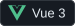
  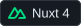
  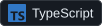
  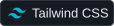
  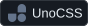

**Backend & Data**

  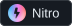
  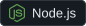
  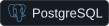
  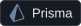
  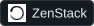

**Testing & Delivery**

  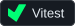
  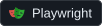
  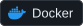
  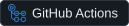
  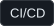

**Secondary**

  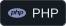
  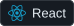
  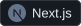

## 🔗 Links

Portfolio: https://benjamintomanik.me  
LinkedIn: https://www.linkedin.com/in/benjamin-toman%C3%ADk-622404346/
